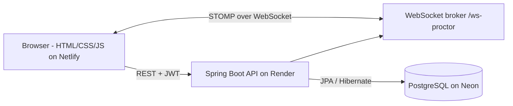

# Exam Proctor

A multi-tenant online examination platform. Several colleges (tenants) share one deployment, and each college only sees its own exams, students and results. Admins create exams, students take them in the browser, and suspicious activity during an exam (switching tabs, copy/paste, right-click) is sent to the admin's dashboard in real time.

**Live demo:** https://exxamproctor.netlify.app

The backend runs on Render's free plan, so the first request after a quiet period can take up to a minute while the server wakes up.

## Features

- **Multi-tenant:** every organization has a unique tenant slug (for example `kletech`). The tenant is stored inside the signed JWT, and every request is checked against it.
- **Three roles**, enforced on the backend with Spring Security:
  - `SUPER_ADMIN` onboards organizations and creates their first admin.
  - `ORG_ADMIN` adds students, creates and assigns exams, watches live exams, and grades written answers.
  - `STUDENT` takes assigned exams and sees past results.
- **Scheduled exams:** every exam has a start and an end time. Students see their upcoming and open exams with a countdown to the start or the end, and an exam leaves their list once it closes.
- **Automatic closing:** a background job runs every minute. When an exam's end time passes, it moves to "Past", and any attempt still in progress is submitted and flagged as late.
- **Grading:** multiple-choice questions are graded automatically when the student submits. The admin opens a submission from Reports, sees each answer next to the expected answer, and marks the written answers. Correct answers are never sent to students' browsers.
- **Live proctoring:** the exam page reports tab switches, window blur, copy/cut/paste and right-clicks over WebSockets (STOMP). The admin dashboard receives them instantly.
- **Server-side checks:** a student can only start exams assigned to them, only once, and only while the exam is open. Late submissions are saved but flagged.
- **Messaging** between students, their organization's admin, and the super admin, with separate inbox and sent views.
- **Student management:** add students one by one or in bulk, reset a student's password, or revoke their access.

## Tech stack

| Part | Technology |
| --- | --- |
| Backend | Java 21, Spring Boot 3.3, Spring Web, Spring Data JPA (Hibernate), Spring Security, JWT (jjwt), Spring WebSocket (STOMP + SockJS), Lombok |
| Database | PostgreSQL (hosted on Neon) |
| Frontend | HTML, CSS and vanilla JavaScript (no framework) |
| Testing | JUnit 5, Mockito, H2 in-memory database |
| Deployment | Docker (backend on Render), Netlify (frontend) |

## Architecture



Every REST request goes through two filters before reaching a controller:

1. `JwtAuthenticationFilter` checks the `Authorization: Bearer <token>` header and logs the user in for that request.
2. `TenantFilter` checks that the `X-Tenant-ID` header matches the tenant inside the token, then stores it in a `ThreadLocal` (`TenantContext`) for the services to use.

## Project structure

```
exam-proctor-system/
├── backend/                     Spring Boot application
│   ├── src/main/java/com/proctor/backend/
│   │   ├── config/              security, JWT, WebSocket and seed data
│   │   ├── controller/          REST and WebSocket endpoints
│   │   ├── service/             business logic
│   │   ├── repository/          Spring Data JPA repositories
│   │   ├── model/               JPA entities and enums
│   │   ├── dto/                 request / response objects
│   │   ├── filter/              JWT and tenant filters
│   │   ├── context/             per-request tenant holder
│   │   └── exception/           global error handling
│   ├── src/test/                unit tests (run with an in-memory H2 database)
│   └── Dockerfile
├── frontend/
│   ├── css/                     base, layout, components, pages, helpers
│   ├── js/                      one script per page + shared api.js / websocket.js
│   └── *.html
└── docs/
```

## Running locally

**Requirements:** JDK 21, Maven (or the included `mvnw`), PostgreSQL.

1. Create a database:

   ```sql
   CREATE DATABASE proctor_saas;
   ```

2. Start the backend. It runs on `http://localhost:8080`, and Hibernate creates the tables on first start.

   ```bash
   cd backend
   ./mvnw spring-boot:run
   ```

3. Serve the frontend, then open `http://localhost:3000`. The frontend calls `localhost:8080` automatically when it runs on localhost.

   ```bash
   cd frontend
   python -m http.server 3000
   ```

### Environment variables

All have local defaults, so none are needed for local development. See `backend/.env.example`.

| Variable | Purpose | Local default |
| --- | --- | --- |
| `DB_URL` | JDBC URL of the database | `jdbc:postgresql://localhost:5432/proctor_saas` |
| `DB_USER` / `DB_PASS` | Database login | `postgres` / `postgre` |
| `JWT_SECRET` | Base64 key used to sign tokens. **Always set this in production.** | development key |
| `JWT_EXPIRATION` | Token lifetime in milliseconds | `86400000` (24 h) |
| `FRONTEND_URL` | Allowed CORS origins, comma separated | `*` |
| `SHOW_SQL` | Print SQL queries to the console | `false` |

### Demo accounts

On first start with an empty database, `DatabaseSeeder` creates one organization (`kletech`), these accounts, and a sample exam that is open for 30 days and assigned to the demo student.

| Role | Email |
| --- | --- |
| Super admin | `super@proctor.com` |
| Organization admin | `admin@kletech.edu` |
| Student | `student@kletech.edu` |

## Running the tests

```bash
cd backend
./mvnw test
```

The tests use an in-memory H2 database, so PostgreSQL does not need to be running. They cover the main rules: students can only take assigned exams, exams need a valid schedule and close on time, late submissions are flagged, and users can only read message threads they belong to.

## API overview

All endpoints are under `/api/v1`. Every endpoint except login needs `Authorization: Bearer <token>`. Tenant-scoped endpoints also need `X-Tenant-ID: <tenant slug>`.

| Method | Endpoint | Role |
| --- | --- | --- |
| POST | `/auth/login` | public |
| GET, POST | `/organizations` | SUPER_ADMIN |
| POST | `/organizations/{id}/admin` | SUPER_ADMIN |
| GET | `/system/stats` | SUPER_ADMIN |
| POST | `/exams` | ORG_ADMIN |
| POST | `/exams/{id}/assign` | ORG_ADMIN |
| PUT | `/exams/{id}/status` | ORG_ADMIN |
| GET | `/exams`, `/exams/{id}` | ORG_ADMIN, STUDENT |
| GET | `/exams/missed` | STUDENT |
| POST | `/attempts/start?examId=` | STUDENT |
| POST | `/attempts/{id}/submit` | STUDENT |
| GET | `/attempts/my-active` | STUDENT |
| GET | `/attempts/active` | ORG_ADMIN |
| POST | `/attempts/{id}/grade` | ORG_ADMIN |
| GET | `/attempts/history`, `/attempts/{id}/logs`, `/attempts/{id}/answers` | ORG_ADMIN, STUDENT (own data only) |
| GET, POST | `/users/students`, `/users`, `/users/students/bulk` | ORG_ADMIN |
| POST | `/users/students/{id}/reset-password`, `/users/students/{id}/revoke` | ORG_ADMIN |
| GET, PUT | `/users/me`, `/users/me/password` | any logged-in user |
| GET | `/analytics/dashboard` | ORG_ADMIN |
| GET, POST, PUT | `/messages/...` | any logged-in user |

Errors always use the same JSON format:

```json
{ "timestamp": "...", "status": 404, "error": "Not Found", "message": "exam not found", "path": "/api/v1/exams/..." }
```

## Deployment

- **Backend:** Render builds `backend/Dockerfile`, a multi-stage build that compiles with Maven and runs on a slim Java 21 JRE image. Set the environment variables above in Render.
- **Frontend:** the `frontend` folder is deployed as a static site on Netlify.
- **Database:** PostgreSQL on Neon.

## License

MIT, see [LICENSE](LICENSE).
